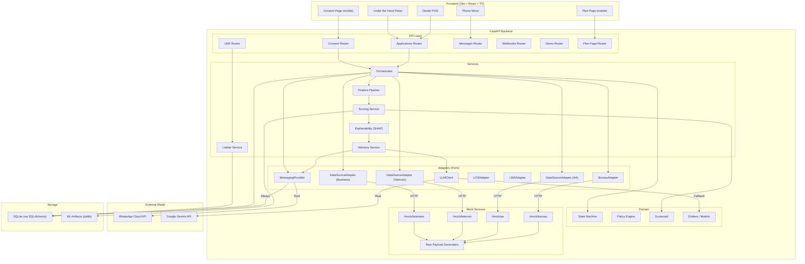
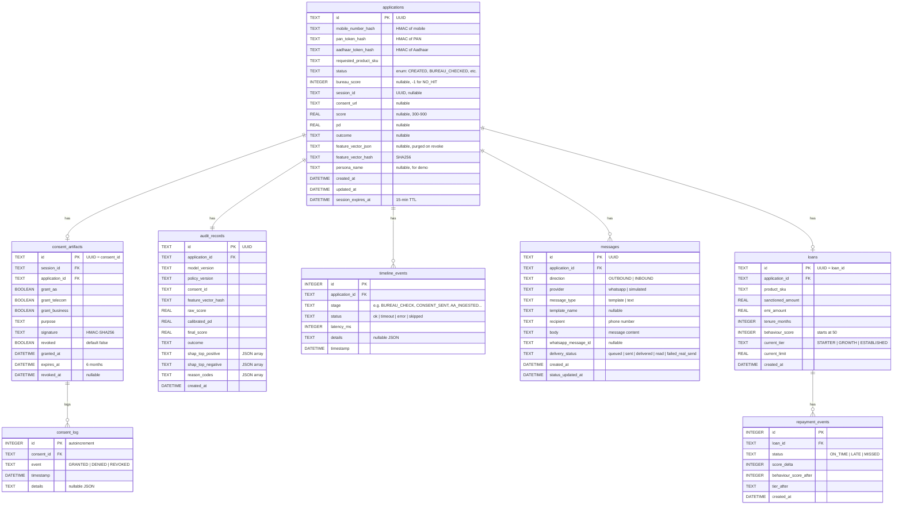
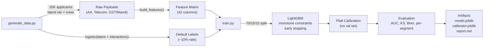
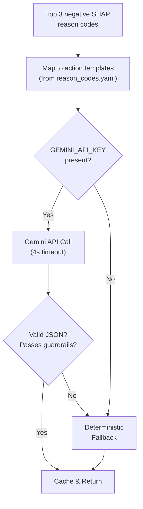
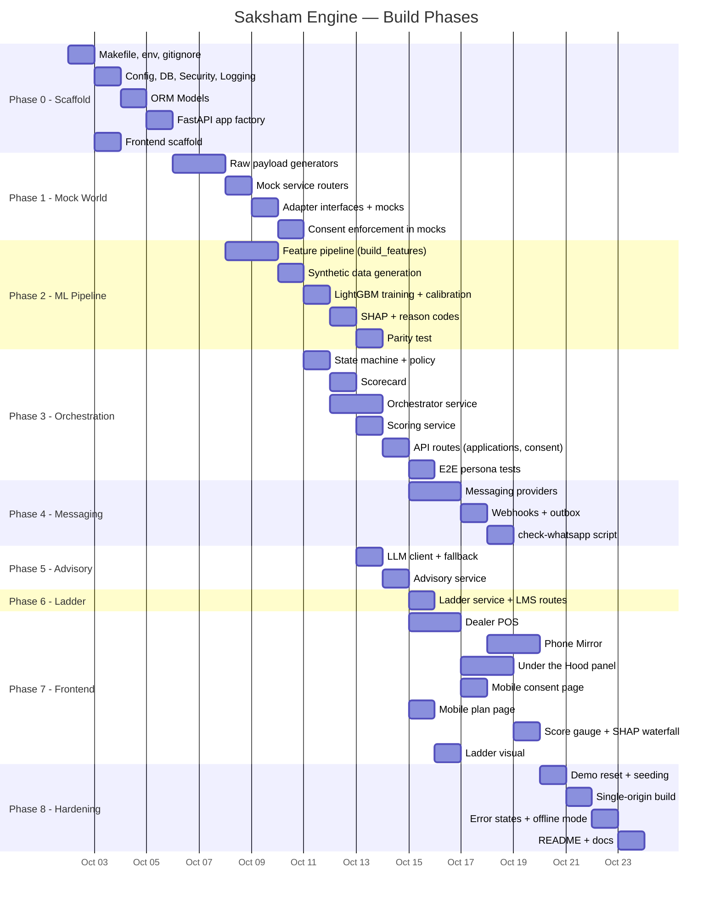

# Saksham Engine — Detailed Implementation Plan

> **Status:** ✅ Finalized — ready to code.

---

## Table of Contents

1. [Assumptions & Decisions](#1-assumptions--decisions)
2. [Architecture Overview](#2-architecture-overview)
3. [Repository Layout](#3-repository-layout)
4. [Database Schema](#4-database-schema)
5. [API Contracts (Refined)](#5-api-contracts-refined)
6. [Phase 0 — Scaffold](#phase-0--scaffold)
7. [Phase 1 — Mock World & Generators](#phase-1--mock-world--generators)
8. [Phase 2 — ML Pipeline](#phase-2--ml-pipeline)
9. [Phase 3 — Orchestration & State Machine](#phase-3--orchestration--state-machine)
10. [Phase 4 — Messaging](#phase-4--messaging)
11. [Phase 5 — LLM Advisory](#phase-5--llm-advisory)
12. [Phase 6 — Graduation Ladder](#phase-6--graduation-ladder)
13. [Phase 7 — Frontend](#phase-7--frontend)
14. [Phase 8 — Hardening & Demo Mode](#phase-8--hardening--demo-mode)
15. [Risks & Mitigations](#risks--mitigations)
16. [Dependency Graph](#dependency-graph)

---

## 1. Assumptions & Decisions

### Confirmed Assumptions

| Topic | Decision |
|---|---|
| **Product catalog / SKUs** | 3 products: `TWO_WHEELER` (₹80K ticket, 24-mo, ₹4,200/mo EMI), `USED_CAR` (₹3L ticket, 48-mo, ₹8,500/mo EMI), `TRACTOR` (₹5L ticket, 60-mo, ₹12,000/mo EMI). EMI = flat-rate approximation: `(principal × (1 + rate × tenure_years)) / tenure_months`. Rate = 14% flat for prototype. |
| **Languages for templates** | EN, HI, MR (all three). Deterministic fallback templates in all three languages. LLM advisory also targets all three. |
| **Charting library** | **Recharts** for the SHAP waterfall and score gauge (React-native, lightweight, good enough for demo). |
| **Tunnel** | **ngrok** for public HTTPS tunneling. `PUBLIC_BASE_URL` env var set to the ngrok URL. |
| **Borderline band** | **Include it.** Score 600–649 → `CONDITIONAL_APPROVAL` (lower ticket / co-applicant suggestion). Adds demo drama. |
| **LLM provider** | **Google Gemini** (`gemini-2.0-flash` via `google-generativeai` SDK, env var `GEMINI_API_KEY`, model name from `LLM_MODEL`). Provider-agnostic interface so user can swap. 4-second timeout. |
| **MESSAGING_MODE default** | `both` in dev (tries WhatsApp, always writes outbox). `simulated` when offline. |
| **Demo dealer login** | Simple hardcoded dealer: `dealer_01` / no password (spec says auth is out of scope). Just a name in the header. |
| **Score formula defaults** | `PDO = 60`, `Offset = 487.123` (chosen so score 650 ↔ PD ≈ 7%). `Factor = PDO / ln(2) ≈ 86.56`. Clamp [300, 900]. |
| **Session TTL** | 15 minutes for consent flow. Lazily enforced on read. |
| **Consent artifact TTL** | 6 months from grant. HMAC-SHA256 signed. |
| **Synthetic data size** | 20,000 applicants. Fixed seed = 42. |
| **Feature count** | ~42 features (detailed in Phase 2). |

### WhatsApp Setup (from Meta "Try It Out")

| Setting | Value |
|---|---|
| **Test number** | +1 (555) 669-7571 |
| **Phone Number ID** | `129924074327097` |
| **WhatsApp Business Account ID** | `106611522633989` |
| **API version** | `v25.0` |
| **Demo recipient** | `+91-70700-02780` (verified) |
| **Available template** | `hello_world` (pre-approved, `en_US`) |

### WhatsApp Messaging Strategy

Since only the `hello_world` template is pre-approved, the messaging strategy is:

1. **Consent request**: Send `hello_world` template (business-initiated, always works outside the 24-hour window). The phone mirror in the UI shows the *actual* consent message with the link — this is what the projector audience sees. The real WhatsApp message serves as a notification that triggers the recipient to check the app/link.
2. **Opening the 24-hour window**: The consent page includes a `wa.me` deep link with prefilled text. When the user taps it, their inbound message opens the 24-hour service window.
3. **Result delivery**: Once the window is open, send the full decision / action plan as **free-form text** (no template needed). If the window is closed, fall back to simulated-only (phone mirror shows it).
4. **Fallback**: If any real WhatsApp send fails, the flow continues via the simulated phone mirror — zero breakage.

---

## 2. Architecture Overview



### Key Architectural Choices

- **Hexagonal / Ports-and-Adapters**: All external dependencies accessed through abstract interfaces. Core domain is dependency-free.
- **Single process**: FastAPI serves API, mock services, and (in demo mode) the built frontend — one origin, one tunnel.
- **Async everywhere**: `asyncio.gather` for parallel data ingestion. `httpx.AsyncClient` with per-source 3s timeouts.
- **SQLite + SQLAlchemy 2.0**: Async via `aiosqlite`. Single file, trivial reset.
- **No Redis, no Celery**: Session TTL via DB column. Parallelism via asyncio.

---

## 3. Repository Layout

```
SakshamEngine/
├── README.md
├── Makefile
├── .env.example
├── .gitignore
├── policy.yaml                    # Cutoffs, products, tiers, TTLs
├── reason_codes.yaml              # Feature → reason code mapping + templates
├── spec.md
│
├── backend/
│   ├── requirements.txt
│   ├── app/
│   │   ├── __init__.py
│   │   ├── main.py                # FastAPI app factory, lifespan, middleware
│   │   │
│   │   ├── api/                   # Route handlers (thin — delegate to services)
│   │   │   ├── __init__.py
│   │   │   ├── applications.py    # POST /create, GET /{id}, GET /{id}/trace, GET /{id}/decision
│   │   │   ├── consent.py         # POST /authorize, POST /revoke
│   │   │   ├── lms.py             # POST /repayment-event, GET /customers/{id}/ladder
│   │   │   ├── messages.py        # GET /messages/{application_id}
│   │   │   ├── webhooks.py        # GET & POST /webhooks/whatsapp
│   │   │   ├── demo.py            # POST /reset, GET /personas
│   │   │   └── plan.py            # GET /plan/{application_id} (HTML page)
│   │   │
│   │   ├── core/                  # Cross-cutting concerns
│   │   │   ├── __init__.py
│   │   │   ├── config.py          # Pydantic Settings from env + policy.yaml
│   │   │   ├── security.py        # HMAC signing, token hashing, secret masking
│   │   │   ├── database.py        # SQLAlchemy async engine, session factory
│   │   │   ├── logging.py         # Structured logging (no secrets)
│   │   │   └── errors.py          # Consistent error model + exception handlers
│   │   │
│   │   ├── domain/                # Pure domain logic, no I/O
│   │   │   ├── __init__.py
│   │   │   ├── entities.py        # Pydantic models: Application, Consent, AuditRecord, etc.
│   │   │   ├── state_machine.py   # Allowed transitions, validate_transition()
│   │   │   ├── policy.py          # Decision logic, cutoff checks, borderline band
│   │   │   └── scorecard.py       # PD→score, score→PD, clamp, lookup table
│   │   │
│   │   ├── models/                # SQLAlchemy ORM models
│   │   │   ├── __init__.py
│   │   │   ├── application.py
│   │   │   ├── consent.py
│   │   │   ├── audit.py
│   │   │   ├── message.py
│   │   │   ├── loan.py            # LMS mock loan + repayment events
│   │   │   └── session.py
│   │   │
│   │   ├── adapters/              # Port interfaces + implementations
│   │   │   ├── __init__.py
│   │   │   ├── interfaces.py      # Abstract base classes for all adapters
│   │   │   ├── bureau.py          # BureauAdapter → calls /mock/bureau/check
│   │   │   ├── data_sources.py    # AAAdapter, TelecomAdapter, BusinessAdapter
│   │   │   ├── los.py             # LOSAdapter (mock, in-process)
│   │   │   ├── lms.py             # LMSAdapter (mock, in-process)
│   │   │   ├── messaging/
│   │   │   │   ├── __init__.py
│   │   │   │   ├── interface.py   # MessagingProvider ABC
│   │   │   │   ├── whatsapp.py    # WhatsAppCloudProvider
│   │   │   │   ├── simulated.py   # SimulatedProvider
│   │   │   │   └── manager.py     # Routes to correct provider(s) based on MESSAGING_MODE
│   │   │   └── llm/
│   │   │       ├── __init__.py
│   │   │       ├── interface.py   # LLMClient ABC
│   │   │       ├── gemini.py      # GeminiLLMClient (google-generativeai SDK)
│   │   │       └── fallback.py    # DeterministicFallbackClient
│   │   │
│   │   ├── services/              # Application services (orchestrate domain + adapters)
│   │   │   ├── __init__.py
│   │   │   ├── orchestrator.py    # Main flow: create → bureau → consent → ingest → score → decide
│   │   │   ├── feature_pipeline.py# build_features(raw_payloads, requested_emi) → feature_row
│   │   │   ├── scoring.py         # Load model, predict, calibrate, scorecard
│   │   │   ├── explainability.py  # SHAP values, reason code mapping
│   │   │   ├── advisory.py        # LLM call + fallback → action plan
│   │   │   └── ladder.py          # Behaviour score, tier progression
│   │   │
│   │   └── mock_services/         # Mock data endpoints
│   │       ├── __init__.py
│   │       ├── routers.py         # /mock/* FastAPI routers
│   │       └── generators.py      # Shared raw-payload generators (used by mocks AND ml/generate_data.py)
│   │
│   ├── ml/
│   │   ├── generate_data.py       # Synthetic data: raw payloads → build_features → labels
│   │   ├── train.py               # LightGBM training, calibration, evaluation
│   │   └── artifacts/             # model.joblib, calibrator.joblib, feature_schema.json, report.md
│   │
│   └── tests/
│       ├── conftest.py
│       ├── test_generators.py
│       ├── test_feature_pipeline.py
│       ├── test_feature_parity.py  # Same raw payloads → identical features in train & serve
│       ├── test_state_machine.py
│       ├── test_consent.py
│       ├── test_scorecard.py
│       ├── test_advisory.py
│       └── test_e2e_personas.py    # All 7 personas end-to-end
│
├── frontend/
│   ├── package.json
│   ├── vite.config.ts
│   ├── tailwind.config.js
│   ├── tsconfig.json
│   ├── index.html
│   └── src/
│       ├── main.tsx
│       ├── App.tsx
│       ├── api/                    # API client, types
│       │   ├── client.ts
│       │   └── types.ts
│       ├── components/
│       │   ├── DealerPOS/
│       │   │   ├── ApplicationForm.tsx
│       │   │   ├── StatusTimeline.tsx
│       │   │   └── DecisionCard.tsx
│       │   ├── PhoneMirror/
│       │   │   ├── PhoneFrame.tsx
│       │   │   ├── MessageBubble.tsx
│       │   │   └── ConsentPreview.tsx
│       │   ├── UnderTheHood/
│       │   │   ├── PipelineTrace.tsx
│       │   │   ├── ScoreGauge.tsx
│       │   │   ├── SHAPWaterfall.tsx
│       │   │   ├── SourceStatus.tsx
│       │   │   └── LadderVisual.tsx
│       │   ├── ConsentPage/        # Mobile-first, standalone route
│       │   │   └── ConsentPage.tsx
│       │   └── PlanPage/           # Mobile-first, standalone route
│       │       └── PlanPage.tsx
│       ├── hooks/
│       │   ├── usePolling.ts
│       │   └── useApplication.ts
│       └── styles/
│           └── index.css
│
├── scripts/
│   └── check_whatsapp.py          # Validate credentials, send test message
│
└── docs/
    ├── demo_script.md
    └── architecture.md
```

---

## 4. Database Schema



---

## 5. API Contracts (Refined)

> [!NOTE]
> I've kept the spec's contracts largely intact but refined payloads for clarity. All responses share the error shape `{ "error": { "code": "...", "message": "..." } }`.

### Core Application APIs

#### `POST /api/v1/applications/create`

```json
// Request
{
  "mobile_number": "9876543210",
  "pan_token": "ABCDE1234F",
  "aadhaar_token": "masked-token",
  "requested_product_sku": "TWO_WHEELER",
  "applicant_name": "Ravi Kumar",         // Added: needed for WhatsApp templates
  "preferred_language": "hi"               // Added: en | hi | mr
}

// Response (NO_HIT case)
{
  "application_id": "uuid",
  "status": "AWAITING_CONSENT",
  "session_id": "uuid",
  "consent_url": "https://<PUBLIC_BASE_URL>/consent/<session_id>",
  "bureau_result": "NO_HIT",
  "message": "Consent request sent via WhatsApp"
}

// Response (bureau HIT, score >= 700)
{
  "application_id": "uuid",
  "status": "BYPASSED_TO_LOS",
  "bureau_result": "HIT",
  "bureau_score": 760,
  "message": "Bureau score sufficient. Routed to standard LOS."
}
```

#### `GET /api/v1/applications/{id}`

Returns full application state including all timeline events, current outcome, and linked entities.

#### `GET /api/v1/applications/{id}/trace`

```json
{
  "application_id": "uuid",
  "stages": [
    { "stage": "BUREAU_CHECK", "status": "ok", "latency_ms": 45, "timestamp": "...", "details": { "result": "NO_HIT" } },
    { "stage": "CONSENT_REQUEST_SENT", "status": "ok", "latency_ms": 320, "timestamp": "...", "details": { "provider": "whatsapp", "delivery_status": "delivered" } },
    { "stage": "CONSENT_GRANTED", "status": "ok", "latency_ms": null, "timestamp": "..." },
    { "stage": "AA_INGESTION", "status": "ok", "latency_ms": 180, "timestamp": "..." },
    { "stage": "TELECOM_INGESTION", "status": "timeout", "latency_ms": 3000, "timestamp": "...", "details": { "degraded": true } },
    { "stage": "BUSINESS_INGESTION", "status": "ok", "latency_ms": 95, "timestamp": "..." },
    { "stage": "FEATURE_BUILD", "status": "ok", "latency_ms": 12, "timestamp": "..." },
    { "stage": "SCORING", "status": "ok", "latency_ms": 8, "timestamp": "..." },
    { "stage": "DECISION", "status": "ok", "latency_ms": 1, "timestamp": "...", "details": { "outcome": "APPROVED" } }
  ],
  "total_latency_ms": 661,
  "message_delivery": { "consent_request": "read", "result_delivery": "delivered" }
}
```

#### `GET /api/v1/applications/{id}/decision`

```json
{
  "application_id": "uuid",
  "score": 712,
  "pd": 0.042,
  "outcome": "APPROVED",
  "shap_drivers": {
    "positive": [
      { "feature": "buffer_ratio", "shap_value": 0.85, "reason_code": "RC001", "reason_text": "Strong savings buffer relative to EMI" },
      { "feature": "recharge_regularity", "shap_value": 0.42, "reason_code": "RC012", "reason_text": "Consistent mobile recharge pattern" }
    ],
    "negative": [
      { "feature": "bounce_velocity", "shap_value": -0.31, "reason_code": "RC003", "reason_text": "Some recent payment bounces" }
    ]
  },
  "audit_record_id": "uuid",
  "model_version": "v1-lgbm-20261002",
  "policy_version": "v1.0"
}
```

### Consent APIs

#### `POST /api/v1/consent/authorize`

```json
// Request
{
  "session_id": "uuid",
  "grants": { "aa": true, "telecom": true, "business": false },
  "purpose": "Alternative credit assessment for TWO_WHEELER loan"
}

// Response
{
  "consent_id": "uuid",
  "session_id": "uuid",
  "grants": { "aa": true, "telecom": true, "business": false },
  "granted_at": "2026-10-02T10:00:00Z",
  "expires_at": "2027-04-02T10:00:00Z",
  "revocable": true,
  "signature": "hmac-sha256-hex"
}
```

#### `POST /api/v1/consent/revoke`

```json
// Request
{ "consent_id": "uuid" }

// Response
{ "consent_id": "uuid", "revoked": true, "features_purged": true }
```

### Mock Data Sources

All mock endpoints require header `X-Consent-Token: <consent_id>`. The mock router validates the consent is granted, not revoked, not expired, and covers the requested source group. Query param `?simulate_outage=true` forces a timeout.

| Endpoint | Method | Consent Group | Response Shape |
|---|---|---|---|
| `/mock/bureau/check` | POST | *(none)* | `{ status, score }` |
| `/mock/aa/bank-statement?mobile_hash=...` | GET | `aa` | `{ account, balances[], transactions[] }` |
| `/mock/telecom/recharge?mobile_hash=...` | GET | `telecom` | `{ sim_start_date, recharges[] }` |
| `/mock/business/gst-returns?mobile_hash=...` | GET | `business` | `{ gstin_token, returns[] }` |
| `/mock/business/mandi-receipts?mobile_hash=...` | GET | `business` | `{ receipts[] }` |

### Ladder / LMS

#### `POST /api/v1/lms/repayment-event`

```json
// Request
{ "loan_id": "uuid", "status": "ON_TIME" }

// Response
{
  "loan_id": "uuid",
  "event_recorded": true,
  "behaviour_score": 62,
  "previous_tier": "STARTER",
  "current_tier": "STARTER",
  "current_limit": 80000,
  "next_tier": "GROWTH",
  "next_tier_requirement": "Behaviour score ≥ 70 (need 8 more points)"
}
```

### Messages & Webhooks

- `GET /api/v1/messages/{application_id}` — returns ordered outbox for the phone mirror.
- `GET /webhooks/whatsapp` — Meta verification challenge.
- `POST /webhooks/whatsapp` — Inbound messages + delivery status updates.

### Demo Helpers

- `POST /demo/reset` — Wipes DB, reseeds all 7 personas.
- `GET /demo/personas` — Returns persona list with mobile numbers and expected outcomes.
- `POST /demo/simulate-repayments` — Body `{ loan_id, count: 6, status: "ON_TIME" }`. Bulk-simulates EMIs.

---

## Phase 0 — Scaffold

> **Goal:** `make dev` starts both backend and frontend. Health endpoint responds.

### Files to Create

| File | Purpose |
|---|---|
| `Makefile` | `dev`, `train`, `seed`, `build-demo`, `check-whatsapp`, `test`, `reset` targets |
| `.env.example` | All env vars with placeholder values |
| `.gitignore` | Python, Node, .env, SQLite, artifacts |
| `policy.yaml` | Products, cutoffs, tiers, TTLs, scorecard params |
| `reason_codes.yaml` | Feature-to-reason-code mapping + EN/HI/MR templates |
| `backend/requirements.txt` | All Python deps pinned |
| `backend/app/main.py` | FastAPI app factory with lifespan (DB init, model loading) |
| `backend/app/core/config.py` | Pydantic `Settings` class loading `.env` + `policy.yaml` |
| `backend/app/core/database.py` | Async SQLAlchemy engine + session maker |
| `backend/app/core/security.py` | HMAC helpers, token hashing, masking |
| `backend/app/core/errors.py` | Error model + exception handlers |
| `backend/app/core/logging.py` | Structured logger with secret filtering |
| `backend/app/models/*.py` | All SQLAlchemy ORM models (from schema above) |
| `frontend/` | Vite + React + TS + Tailwind scaffold |

### Acceptance Check

```bash
make dev
# Backend: http://localhost:8000/health → {"status": "ok"}
# Frontend: http://localhost:5173 → renders shell UI
```

### Order of Work

1. `Makefile`, `.env.example`, `.gitignore`
2. `policy.yaml`, `reason_codes.yaml`
3. `backend/requirements.txt` → `pip install`
4. `core/config.py` → `core/database.py` → `core/security.py` → `core/errors.py` → `core/logging.py`
5. All ORM models
6. `main.py` (app factory, mount health route, create tables on startup)
7. Frontend scaffold (`npm create vite@latest`, install Tailwind, Recharts)
8. Wire `make dev` to run both

---

## Phase 1 — Mock World & Generators

> **Goal:** Deterministic, persona-seeded mock data. Consent enforcement proven.

### Files to Create

| File | Purpose |
|---|---|
| `backend/app/mock_services/generators.py` | `generate_aa_payload()`, `generate_telecom_payload()`, `generate_gst_payload()`, `generate_mandi_payload()`, `generate_bureau_result()` — all seeded by mobile_number hash → persona |
| `backend/app/mock_services/routers.py` | FastAPI router for all `/mock/*` endpoints |
| `backend/app/adapters/interfaces.py` | ABCs: `BureauAdapter`, `DataSourceAdapter`, `LOSAdapter`, `LMSAdapter`, `MessagingProvider`, `LLMClient` |
| `backend/app/adapters/bureau.py` | `MockBureauAdapter` → HTTP call to `/mock/bureau/check` |
| `backend/app/adapters/data_sources.py` | `MockAAAdapter`, `MockTelecomAdapter`, `MockBusinessAdapter` → HTTP calls |
| `backend/tests/test_generators.py` | Determinism tests, persona coverage |

### Generator Design

```python
# generators.py — shared between mock services and training data

def persona_seed(mobile_number: str) -> int:
    """Deterministic seed from mobile number."""
    return int(hashlib.sha256(mobile_number.encode()).hexdigest()[:8], 16)

def generate_creditworthiness(seed: int) -> float:
    """Latent variable [0, 1]. Higher = more creditworthy."""
    rng = np.random.default_rng(seed)
    return rng.beta(2, 5)  # skewed toward lower values

def generate_aa_payload(seed: int, creditworthiness: float, months: int = 6) -> dict:
    """Raw AA bank statement with transactions. UPI derived from mode field."""
    ...

def generate_telecom_payload(seed: int, creditworthiness: float) -> dict:
    ...

def generate_gst_payload(seed: int, creditworthiness: float) -> dict | None:
    """Returns None if persona is not a merchant."""
    ...

def generate_mandi_payload(seed: int, creditworthiness: float) -> dict | None:
    """Returns None if persona is not a farmer."""
    ...
```

### Consent Enforcement in Mocks

The mock router middleware:
1. Extracts `X-Consent-Token` header.
2. Loads consent artifact from DB.
3. Verifies: exists, not revoked, not expired, signature valid, covers requested source group.
4. If `?simulate_outage=true`, sleeps 5s (triggering the adapter's 3s timeout).

### Acceptance Check

```bash
# With valid consent for AA:
curl -H "X-Consent-Token: <consent_id>" http://localhost:8000/mock/aa/bank-statement?mobile_hash=abc123
# → 200 with bank statement JSON

# Without consent:
curl http://localhost:8000/mock/aa/bank-statement?mobile_hash=abc123
# → 403 { "error": { "code": "CONSENT_REQUIRED", "message": "..." } }
```

---

## Phase 2 — ML Pipeline

> **Goal:** Trained LightGBM model with calibration, SHAP, and verified train/serve parity.

### Files to Create

| File | Purpose |
|---|---|
| `backend/app/services/feature_pipeline.py` | `build_features(raw_payloads, requested_emi) → pd.Series` |
| `backend/ml/generate_data.py` | Calls generators → `build_features` → labels → CSV |
| `backend/ml/train.py` | LightGBM train, calibrate, evaluate, save artifacts |
| `backend/ml/artifacts/` | `model.joblib`, `calibrator.joblib`, `feature_schema.json`, `report.md` |
| `backend/tests/test_feature_pipeline.py` | Unit tests per feature group |
| `backend/tests/test_feature_parity.py` | Parity test: same payloads → identical features |

### Feature List (~42 features)

**Bank Statement / AA (14 features)**

| # | Feature | Formula | Monotone |
|---|---|---|---|
| 1 | `buffer_ratio` | avg_daily_balance / target_emi | ↑ better |
| 2 | `bounce_velocity` | count of ECS_RETURN in last 90 days | ↑ worse |
| 3 | `income_regularity` | 1 - CV of monthly inflows | ↑ better |
| 4 | `monthly_inflow_count` | avg count of credit txns per month | ↑ better |
| 5 | `distinct_upi_counterparties` | count of unique UPI narrations | ↑ better |
| 6 | `cash_vs_digital_ratio` | cash_inflow / total_inflow | neutral |
| 7 | `digital_inflow_share` | (UPI+NEFT+IMPS inflows) / total_inflows | ↑ better |
| 8 | `min_balance_days` | days where balance < 500 | ↑ worse |
| 9 | `balance_trend` | slope of monthly avg balance (normalized) | ↑ better |
| 10 | `avg_monthly_inflow` | mean of monthly total credits | ↑ better |
| 11 | `max_monthly_outflow` | max of monthly total debits | neutral |
| 12 | `salary_regularity` | regularity of large recurring credits | ↑ better |
| 13 | `upi_txn_frequency` | monthly avg UPI transactions | neutral |
| 14 | `balance_volatility` | std of daily balances / mean | ↑ worse |

**Telecom (6 features)**

| # | Feature | Monotone |
|---|---|---|
| 15 | `recharge_frequency_regularity` | ↑ better (1 - std_of_gaps_normalized) |
| 16 | `recharge_count_12m` | ↑ better |
| 17 | `avg_recharge_value` | ↑ better |
| 18 | `recharge_value_trend` | ↑ better |
| 19 | `sim_tenure_months` | ↑ better |
| 20 | `max_recharge_gap_days` | ↑ worse |

**Business — GST (5 features, NaN for non-merchants)**

| # | Feature | Monotone |
|---|---|---|
| 21 | `gst_avg_turnover` | ↑ better |
| 22 | `gst_turnover_volatility` | ↑ worse |
| 23 | `gst_filing_consistency` | ↑ better |
| 24 | `gst_growth_trend` | ↑ better |
| 25 | `gst_months_filed` | ↑ better |

**Business — Mandi (6 features, NaN for non-farmers)**

| # | Feature | Monotone |
|---|---|---|
| 26 | `mandi_settlement_frequency` | ↑ better |
| 27 | `mandi_distinct_cycles` | ↑ better |
| 28 | `mandi_avg_monthly_settlement` | ↑ better |
| 29 | `mandi_avg_settlement_delay` | ↑ worse |
| 30 | `mandi_crop_diversity` | ↑ better |
| 31 | `mandi_tenure_months` | ↑ better |

**Affordability / Application (5 features)**

| # | Feature | Monotone |
|---|---|---|
| 32 | `requested_emi` | ↑ worse |
| 33 | `est_monthly_income` | ↑ better |
| 34 | `emi_to_income_ratio` | ↑ worse |
| 35 | `product_type_encoded` | neutral (categorical) |
| 36 | `ticket_size` | neutral |

**Availability Flags (6 features)**

| # | Feature | Monotone |
|---|---|---|
| 37 | `src_aa_available` | ↑ better |
| 38 | `src_telecom_available` | ↑ better |
| 39 | `src_business_available` | neutral |
| 40 | `data_completeness_score` | ↑ better |
| 41 | `n_sources_available` | ↑ better |
| 42 | `has_business_records` | neutral |

### Training Flow



### Acceptance Check

```bash
make train
# → ml/artifacts/model.joblib, calibrator.joblib, feature_schema.json, report.md
# report.md contains: AUC > 0.80, per-segment AUC, calibration curve, score↔PD table
# Parity test passes:
make test -- -k test_feature_parity
```

---

## Phase 3 — Orchestration & State Machine

> **Goal:** Complete flow from application creation to decision. All 7 personas pass E2E tests.

### Files to Create/Modify

| File | Purpose |
|---|---|
| `backend/app/domain/state_machine.py` | Enum of states, transition table, `validate_transition()` |
| `backend/app/domain/policy.py` | `evaluate_decision(score, pd, product)` → outcome |
| `backend/app/domain/scorecard.py` | `pd_to_score(pd)`, `score_to_pd(score)`, lookup table |
| `backend/app/services/orchestrator.py` | Main flow controller |
| `backend/app/services/scoring.py` | Load model, predict, calibrate |
| `backend/app/services/explainability.py` | SHAP + reason codes |
| `backend/app/api/applications.py` | Route handlers |
| `backend/app/api/consent.py` | Route handlers |
| `backend/tests/test_e2e_personas.py` | All 7 personas |

### State Machine

```python
class ApplicationStatus(str, Enum):
    CREATED = "CREATED"
    BUREAU_CHECKED = "BUREAU_CHECKED"
    BYPASSED_TO_LOS = "BYPASSED_TO_LOS"
    AWAITING_CONSENT = "AWAITING_CONSENT"
    CONSENT_DENIED = "CONSENT_DENIED"
    EXPIRED = "EXPIRED"
    CONSENT_GRANTED = "CONSENT_GRANTED"
    INGESTING = "INGESTING"
    SCORED = "SCORED"
    APPROVED = "APPROVED"
    CONDITIONAL_APPROVAL = "CONDITIONAL_APPROVAL"  # borderline band
    DECLINED_WITH_PLAN = "DECLINED_WITH_PLAN"
    INSUFFICIENT_DATA = "INSUFFICIENT_DATA"

TRANSITIONS = {
    CREATED: [BUREAU_CHECKED],
    BUREAU_CHECKED: [BYPASSED_TO_LOS, AWAITING_CONSENT],
    AWAITING_CONSENT: [CONSENT_DENIED, EXPIRED, CONSENT_GRANTED],
    CONSENT_GRANTED: [INGESTING],
    INGESTING: [SCORED],
    SCORED: [APPROVED, CONDITIONAL_APPROVAL, DECLINED_WITH_PLAN, INSUFFICIENT_DATA],
}
```

### Orchestrator Flow

```python
async def process_application(app_data: CreateApplicationRequest) -> Application:
    # 1. Create application record
    app = create_application(app_data)
    record_timeline(app.id, "CREATED")

    # 2. Bureau check
    bureau_result = await bureau_adapter.check(app.pan_token_hash)
    transition(app, BUREAU_CHECKED)
    record_timeline(app.id, "BUREAU_CHECK", bureau_result)

    if bureau_result.score >= 700 or (bureau_result.status == "HIT" and bureau_result.score < 700):
        transition(app, BYPASSED_TO_LOS)
        await los_adapter.handoff(app)
        return app

    # 3. NO_HIT → Send consent request
    session = create_session(app, ttl=15*60)
    consent_url = f"{PUBLIC_BASE_URL}/consent/{session.id}"
    await messaging.send_template("hello_world", app.mobile, ...)  # pre-approved template
    transition(app, AWAITING_CONSENT)
    return app  # Consent is async; frontend polls

async def on_consent_granted(session_id: str, grants: dict):
    app = get_application_by_session(session_id)
    consent = create_consent_artifact(session_id, grants)  # HMAC-signed
    transition(app, CONSENT_GRANTED)

    # 4. Parallel ingestion with timeouts
    transition(app, INGESTING)
    raw_payloads = await ingest_all_sources(app, consent)  # asyncio.gather, 3s per source

    # 5. Check data sufficiency
    available_groups = count_available_groups(raw_payloads)
    if available_groups < 2:
        transition(app, INSUFFICIENT_DATA)
        return

    # 6. Feature engineering + scoring
    features = build_features(raw_payloads, app.requested_emi)
    raw_score, pd = scoring_service.predict(features)
    score = scorecard.pd_to_score(pd)
    shap_values = explainability.explain(features)

    transition(app, SCORED)

    # 7. Decision
    outcome = policy.evaluate(score, pd, app.product_sku)
    transition(app, outcome)

    # 8. Write audit record
    create_audit_record(app, features, score, pd, outcome, shap_values)

    # 9. Post-decision actions
    if outcome == APPROVED:
        await los_adapter.handoff(app)
        create_loan_account(app, score)
        await messaging.send_result(app, "approved", ...)
    elif outcome == DECLINED_WITH_PLAN:
        plan = await advisory_service.generate_plan(shap_values, app.language, ...)
        await messaging.send_plan(app, plan)
    elif outcome == CONDITIONAL_APPROVAL:
        await messaging.send_conditional(app, ...)
```

### Acceptance Check

```bash
make test -- -k test_e2e_personas
# All 7 personas pass with expected outcomes:
# Persona 1: APPROVED
# Persona 2: DECLINED_WITH_PLAN
# Persona 3: APPROVED
# Persona 4: DECLINED_WITH_PLAN
# Persona 5: BYPASSED_TO_LOS
# Persona 6: CONSENT_DENIED
# Persona 7: APPROVED (degraded AA)
```

---

## Phase 4 — Messaging

> **Goal:** Real WhatsApp messages arrive. Simulated fallback always works.

### Files to Create

| File | Purpose |
|---|---|
| `backend/app/adapters/messaging/interface.py` | `MessagingProvider` ABC |
| `backend/app/adapters/messaging/whatsapp.py` | `WhatsAppCloudProvider` (Graph API) |
| `backend/app/adapters/messaging/simulated.py` | `SimulatedProvider` (outbox-only) |
| `backend/app/adapters/messaging/manager.py` | Routes to provider(s) based on `MESSAGING_MODE` |
| `backend/app/api/webhooks.py` | WhatsApp webhook verification + status updates |
| `backend/app/api/messages.py` | Outbox retrieval for phone mirror |
| `scripts/check_whatsapp.py` | Credential validation + test message |

### WhatsApp Cloud Provider Logic

```python
class WhatsAppCloudProvider(MessagingProvider):
    async def send_template(self, to, template_name, language="en_US", params=None):
        # Override recipient with DEMO_RECIPIENT_NUMBER for test numbers
        actual_recipient = self.demo_recipient or to
        url = f"https://graph.facebook.com/v25.0/{self.phone_number_id}/messages"
        payload = {
            "messaging_product": "whatsapp",
            "to": actual_recipient,
            "type": "template",
            "template": {
                "name": template_name,  # "hello_world" pre-approved
                "language": {"code": language}  # "en_US"
                # No components needed for hello_world (no variables)
            }
        }
        try:
            resp = await self.client.post(url, json=payload, headers=self.auth_headers, timeout=5.0)
            resp.raise_for_status()
            return resp.json()["messages"][0]["id"]
        except Exception as e:
            logger.error(f"WhatsApp send failed: {mask_secrets(str(e))}")
            return None  # Manager marks as failed_real_send, flow continues via simulated
```

### Messaging Manager

```python
class MessagingManager:
    """Routes messages based on MESSAGING_MODE. Always writes to outbox."""

    async def send(self, message: OutgoingMessage):
        # 1. Always write to outbox (for phone mirror)
        db_msg = await self.save_to_outbox(message)

        if self.mode in ("whatsapp", "both"):
            wa_msg_id = await self.whatsapp_provider.send(message)
            if wa_msg_id:
                db_msg.whatsapp_message_id = wa_msg_id
                db_msg.delivery_status = "sent"
            else:
                db_msg.delivery_status = "failed_real_send"

        if self.mode == "simulated":
            db_msg.delivery_status = "sent"  # simulated always succeeds
```

### Acceptance Check

```bash
make check-whatsapp
# → "✓ Credentials valid. Test message sent to +91XXXXXXXXXX. Check your phone."

# Real consent request arrives on phone with correct URL
# If WhatsApp fails, phone mirror still shows the message and flow continues
```

---

## Phase 5 — LLM Advisory

> **Goal:** Vernacular action plans in EN/HI/MR. Works fully offline with deterministic fallback.

### Files to Create

| File | Purpose |
|---|---|
| `backend/app/adapters/llm/interface.py` | `LLMClient` ABC |
| `backend/app/adapters/llm/gemini.py` | Gemini API client via `google-generativeai` SDK (4s timeout) |
| `backend/app/adapters/llm/fallback.py` | Deterministic template renderer |
| `backend/app/services/advisory.py` | Orchestrates LLM call + validation + caching |
| `backend/tests/test_advisory.py` | Tests for both LLM and fallback paths |

### Advisory Flow



### LLM System Prompt

```
You are a financial advisor writing a simple, encouraging action plan for a loan applicant
in {language}. The applicant's name is {first_name}.

You will receive 3 areas where the applicant can improve. For each, write one clear,
actionable step in simple language that a person in a small town can understand.

Rules:
- Never reveal the score or formula
- Never promise approval
- Never invent numbers not provided to you
- Use respectful, encouraging tone
- Maximum 3 steps
- Output strict JSON: { "greeting": "...", "summary": "...", "steps": ["...", "...", "..."], "closing": "..." }
```

### Deterministic Fallback Example (Hindi)

```yaml
# reason_codes.yaml
RC003:
  feature: bounce_velocity
  en: "Reduce payment bounces by ensuring sufficient balance before EMI dates."
  hi: "EMI की तारीख से पहले पर्याप्त बैलेंस रखें ताकि बाउंस न हों।"
  mr: "EMI तारखेपूर्वी पुरेसे बॅलन्स ठेवा म्हणजे बाउन्स होणार नाहीत."
  positive: false
  action_en: "Set up a reminder 2 days before your EMI date to top up your account."
  action_hi: "EMI से 2 दिन पहले अपने खाते में पैसे डालने का रिमाइंडर लगाएं।"
  action_mr: "EMI च्या 2 दिवस आधी तुमच्या खात्यात पैसे भरण्यासाठी स्मरणपत्र लावा."
```

### Acceptance Check

```bash
# With GEMINI_API_KEY unset:
make test -- -k test_advisory
# Persona 4 → valid Marathi plan from deterministic templates
# Persona 2 → valid Hindi plan from deterministic templates

# With GEMINI_API_KEY set:
# Gemini-generated plan passes JSON schema validation and guardrail checks
```

---

## Phase 6 — Graduation Ladder

> **Goal:** Repayment events move customers through tiers. Demo button works.

### Files to Create

| File | Purpose |
|---|---|
| `backend/app/services/ladder.py` | Behaviour score + tier logic |
| `backend/app/api/lms.py` | Repayment event + ladder query endpoints |

### Tier Configuration (from `policy.yaml`)

```yaml
ladder:
  tiers:
    STARTER:
      min_behaviour_score: 0
      limits:
        TWO_WHEELER: 80000
        USED_CAR: 0        # not eligible yet
        TRACTOR: 0
    GROWTH:
      min_behaviour_score: 70
      limits:
        TWO_WHEELER: 120000
        USED_CAR: 200000
        TRACTOR: 0
    ESTABLISHED:
      min_behaviour_score: 85
      limits:
        TWO_WHEELER: 180000
        USED_CAR: 350000
        TRACTOR: 500000

  scoring:
    initial_score: 50
    on_time_delta: +5    # capped at max 100
    late_delta: -8
    missed_delta: -15
    max_score: 100
    min_score: 0
```

### Acceptance Check

```bash
# Create approved loan for persona 1, then:
curl -X POST /api/v1/lms/repayment-event -d '{"loan_id":"...", "status":"ON_TIME"}'
# Repeat 6 times → score goes 50→55→60→65→70→75→80
# At score 70: tier changes from STARTER → GROWTH
# GET /api/v1/customers/{id}/ladder shows new tier and limits
```

---

## Phase 7 — Frontend

> **Goal:** Full demo without touching the terminal. Projector-friendly, screenshot-worthy.

### Design Language

- **Color palette:** Dark mode base (`#0F172A` slate-900). Green (`#10B981`) for approve, amber (`#F59E0B`) for guidance/decline, blue (`#3B82F6`) for info/progress.
- **Typography:** Inter (Google Fonts).
- **Components:** Glassmorphic cards, smooth transitions, micro-animations on state changes.
- **Layout:** 3-column on desktop: Dealer POS (left), Phone Mirror (center), Under the Hood (right).

### Component Breakdown

#### 1. Dealer POS (left panel)

- **Persona Selector:** Dropdown with all 7 personas. Auto-fills the form.
- **Application Form:** Name, mobile, PAN token, Aadhaar token, product SKU, language preference. Submit button.
- **Status Timeline:** Vertical timeline showing state transitions with timestamps and latencies. Animated as stages complete.
- **Decision Card:** Score gauge, outcome badge (green APPROVED / amber DECLINED), SHAP summary. Appears after scoring.

#### 2. Phone Mirror (center panel)

- **Phone Frame:** Realistic phone bezel with status bar.
- **Message Feed:** Renders outbox messages as WhatsApp-style bubbles (green for outbound). Polls `GET /api/v1/messages/{app_id}` every 2 seconds.
- **Consent Page Preview:** When consent URL is generated, shows an inline preview of the mobile consent page.
- **Plan Page Preview:** Shows the action plan page after decline.
- **Delivery Status:** Checkmarks (✓ sent, ✓✓ delivered, blue ✓✓ read) below each message.

#### 3. Under the Hood (right panel)

- **Pipeline Trace:** Stage-by-stage breakdown with latency bars. Color-coded by status (green ok, amber timeout, gray skipped).
- **Source Status Grid:** AA / Telecom / Business — each shows status icon + latency.
- **Score Gauge:** Circular gauge 300–900 with the cutoff line at 650 marked. Animated fill.
- **SHAP Waterfall:** Horizontal bar chart. Green bars push score up, red bars pull down. Top 6 features.
- **Ladder Visual:** After approval — tier progress bar, current/next tier, what's needed.

#### 4. Mobile Pages (standalone routes)

- **`/consent/{session_id}`:** Mobile-first. Shows applicant name, purpose, three toggle switches for AA/Telecom/Business with plain-language descriptions. "I Authorize" button. "Continue on WhatsApp" deep link. Timer showing session TTL countdown.
- **`/plan/{application_id}`:** Mobile-first. Greeting, summary, 3 action steps with icons, closing. Language toggle. TVS Credit branding.

### Polling Strategy

- Poll `GET /api/v1/applications/{id}` every 2 seconds while status is transitioning.
- Poll `GET /api/v1/messages/{app_id}` every 2 seconds for the phone mirror.
- Stop polling when terminal state reached.

### Acceptance Check

```bash
# Full demo on personas 1 and 2 without touching the terminal:
# 1. Select Persona 1 from dropdown → form auto-fills
# 2. Click Submit → timeline animates through stages
# 3. Phone mirror shows WhatsApp consent request
# 4. Open consent URL on phone (or click mirror) → grant consent
# 5. Pipeline trace fills in → score gauge animates to ~720
# 6. Decision card shows APPROVED with SHAP waterfall
# 7. "Simulate 6 EMIs" button → ladder visual updates
```

---

## Phase 8 — Hardening & Demo Mode

> **Goal:** Cold start to demo-ready in < 2 minutes. Works fully offline.

### Tasks

| Task | Details |
|---|---|
| `/demo/reset` | Wipes DB, recreates tables, seeds all 7 personas. Takes < 5 seconds. |
| Single-origin build | `make build-demo`: builds frontend → `frontend/dist/`, backend serves it as static files at `/`. One process, one port. |
| Timing display | Every stage in the pipeline trace shows wall-clock latency in ms. Total pipeline time prominently displayed. |
| Error states | Graceful UI for: session expired, consent denied, WhatsApp failure, LLM timeout, source outage. No stack traces in UI. |
| Offline mode | `MESSAGING_MODE=simulated`, `LLM_FALLBACK_ONLY=true`. All demo features work without internet. |
| README | Setup instructions, env var reference, demo script, architecture diagram, "synthetic data" disclaimer. |
| Footer | "⚠️ Prototype trained on synthetic data. Not for production use." on every page. |

### Acceptance Check

```bash
# Cold start:
git clone ... && cd SakshamEngine
cp .env.example .env  # edit WhatsApp keys
make build-demo       # installs deps, trains model, builds frontend
make dev              # starts single-origin server
# → Demo-ready in < 2 minutes

# Offline mode:
MESSAGING_MODE=simulated LLM_FALLBACK_ONLY=true make dev
# → Full flow works, messages in phone mirror, deterministic action plans
```

---

## Risks & Mitigations

| Risk | Likelihood | Impact | Mitigation |
|---|---|---|---|
| **WhatsApp template not approved in time** | Medium | High | Simulated provider + phone mirror always works. Template messages fall back to simulated. Document for demo script: "Real WhatsApp works; showing simulated mirror for projector." |
| **WhatsApp token expires during demo** | Medium | High | `make check-whatsapp` before demo. Long-lived system-user token. Graceful fallback to simulated. |
| **LightGBM overfits synthetic data** | Low | Medium | Monotone constraints prevent nonsensical learned relationships. Synthetic data generator calibrated to realistic distributions. Explicit disclaimer. |
| **Score distribution doesn't hit 650 ≈ 7% PD** | Low | Medium | Scorecard offset is config-driven. Adjust after training. Generate and verify score↔PD table. |
| **LLM generates unsafe/incorrect advisory** | Low | High | Post-validation: JSON schema check, guardrail check (no score leaks, no promises). Deterministic fallback if any check fails. |
| **Consent page not reachable from phone** | Medium | High | Test with ngrok tunnel early. `make check-whatsapp` validates `PUBLIC_BASE_URL`. Document `ngrok http 8000` in README. |
| **Demo takes too long (> 5 min)** | Medium | High | Pre-seeded personas, deterministic data, pre-trained model. Pipeline target < 200ms. Practice demo script. |
| **SQLite concurrent access issues** | Low | Low | Single-user demo. WAL mode enabled. Async sessions properly scoped. |

---

## Dependency Graph



---

## Summary

| Phase | Key Deliverable | Est. Effort |
|---|---|---|
| **0. Scaffold** | `make dev` runs both apps | ~1 day |
| **1. Mock World** | Deterministic generators + consent-enforced mock APIs | ~2 days |
| **2. ML Pipeline** | Trained LightGBM, calibrated scorecard, parity test passes | ~2 days |
| **3. Orchestration** | Full state machine, all 7 personas pass E2E | ~2 days |
| **4. Messaging** | Real WhatsApp + simulated fallback | ~1.5 days |
| **5. Advisory** | LLM + deterministic EN/HI/MR plans | ~1 day |
| **6. Ladder** | Tier progression with repayment events | ~0.5 days |
| **7. Frontend** | All views, mobile pages, charts | ~3 days |
| **8. Hardening** | Demo-ready, offline-capable, documented | ~1 day |
| **Total** | | **~14 days** |

> [!NOTE]
> All decisions finalized. Ready to begin coding Phase 0.
